# Measured experiment results

Run `20261117T134918168631Z` used the **full** profile, seed 42,
and 5 stratified CV folds. Python 3.14.0 and pinned package
versions are recorded in the local run metadata. Dataset SHA-256 is
`76274b691b16a6c49d3f159c883398e03ccd6d1ee12d9d8ee38f4b4b98551a89`.

## Observed dataset and partitions

The source CSV contains **284,807 transactions**, with 492 fraud
and 284,315 legitimate transactions (0.1727% fraud).
It has 0 missing feature cells and 1,081
exact duplicates. Modeling collapsed 1,081 duplicate
rows and excluded 0 rows with contradictory labels at
identical feature values. The common fitting pool had 181,584 rows and the
threshold validation pool had 45,396 rows with 76 fraud.
The holdout had 56,746 rows with 95 fraud, an all-legitimate
accuracy of 99.8326% and a no-skill AP of
0.00167.

## Model comparison

**mlp** led common validation AP (0.8300).
Its holdout AP was **0.8066**. At its validation-selected
threshold, it caught **69 of 95**
holdout fraud cases and flagged **3 legitimate transactions**.
The highest observed holdout AP belonged to **mlp**
(0.8066). Model deployment selection was fixed
before evaluating holdout scores.

Random forest and XGBoost reached holdout AP of 0.7824
and 0.7700. At their own validation-selected
thresholds, they flagged 1 and
13 legitimate transactions, respectively.

AP, ROC AUC and CV AP use continuous scores. The other rates use the stored threshold.
SVM thresholds refer to signed margins. Training seconds include CV and the final refit.
Scoring time per row is normalized from one complete holdout batch.

| Model | Fit rows | CV AP ± SD | Validation AP | Holdout AP | ROC AUC | Accuracy | Precision | Recall | F1 |
| --- | --- | --- | --- | --- | --- | --- | --- | --- | --- |
| logistic | 181,584 | 0.7484 ± 0.0542 | 0.8019 | 0.6988 | 0.9590 | 0.9993 | 0.8256 | 0.7474 | 0.7845 |
| tree | 181,584 | 0.7391 ± 0.0633 | 0.7037 | 0.6570 | 0.8787 | 0.9993 | 0.8354 | 0.6947 | 0.7586 |
| forest | 181,584 | 0.8421 ± 0.0441 | 0.8153 | 0.7824 | 0.9750 | 0.9995 | 0.9857 | 0.7263 | 0.8364 |
| svm | 30,000 | 0.7240 ± 0.1364 | 0.7894 | 0.7027 | 0.9278 | 0.9994 | 0.8831 | 0.7158 | 0.7907 |
| knn | 40,000 | 0.7047 ± 0.1140 | 0.7491 | 0.6683 | 0.8577 | 0.9993 | 0.8590 | 0.7053 | 0.7746 |
| mlp | 181,584 | 0.8087 ± 0.0390 | 0.8300 | 0.8066 | 0.9645 | 0.9995 | 0.9583 | 0.7263 | 0.8263 |
| xgboost | 181,584 | 0.8213 ± 0.0574 | 0.8021 | 0.7700 | 0.9598 | 0.9993 | 0.8415 | 0.7263 | 0.7797 |

| Model | Threshold | False positives | False negatives | FPR | FNR | Search + fit seconds | Scoring μs/row |
| --- | --- | --- | --- | --- | --- | --- | --- |
| logistic | 0.0893 | 15 | 24 | 0.000265 | 0.2526 | 331.05 | 0.68 |
| tree | 0.5663 | 13 | 29 | 0.000229 | 0.3053 | 173.45 | 0.39 |
| forest | 0.5010 | 1 | 26 | 0.000018 | 0.2737 | 259.89 | 1.48 |
| svm | 20.5639 | 9 | 27 | 0.000159 | 0.2842 | 112.83 | 83.41 |
| knn | 0.6000 | 11 | 28 | 0.000194 | 0.2947 | 83.00 | 152.87 |
| mlp | 0.5652 | 3 | 26 | 0.000053 | 0.2737 | 129.09 | 1.46 |
| xgboost | 0.3216 | 13 | 26 | 0.000229 | 0.2737 | 56.52 | 1.24 |

## Learning diagnostics and regularization

The following rows give the largest training size in each diagnostic curve, with the change
in validation AP from the smallest size. The separate diagnostic pool contains
30,000 rows.

| Model | Rows/fold | Train AP | Validation AP | Train − validation | Validation AP change from smallest size |
| --- | --- | --- | --- | --- | --- |
| logistic | 24000 | 0.7505 | 0.7585 | -0.0081 | +0.0604 |
| tree | 24000 | 0.7906 | 0.6604 | 0.1301 | +0.3770 |
| forest | 24000 | 0.9985 | 0.7962 | 0.2024 | +0.0216 |
| mlp | 24000 | 0.6357 | 0.5989 | 0.0369 | +0.5929 |

At the largest diagnostic size, **forest** had the widest observed train–validation
AP gap, consistent with greater sensitivity to the fitted sample. Curve shapes help
distinguish persistent gaps from gaps that shrink with added data. Rare fraud and limited
fold counts make the curve differences noisy.

Logistic CV varies penalty, strength and imbalance policy. Compare cells with the same
treatment and C to isolate the penalty comparison.

| Penalty | C | Imbalance treatment | CV train AP | CV validation AP | CV SD |
| --- | --- | --- | --- | --- | --- |
| L2 | 0.1 | Original | 0.7579 | 0.7484 | 0.0542 |
| L2 | 1.0 | Original | 0.7591 | 0.7448 | 0.0526 |
| L2 | 1.0 | SMOTE | 0.7522 | 0.7440 | 0.0525 |
| L1 | 1.0 | SMOTE | 0.7522 | 0.7438 | 0.0525 |
| L1 | 1.0 | Original | 0.7582 | 0.7437 | 0.0523 |
| L2 | 0.1 | SMOTE | 0.7517 | 0.7434 | 0.0551 |
| L1 | 0.1 | SMOTE | 0.7510 | 0.7425 | 0.0545 |
| L1 | 1.0 | Class weighting | 0.7425 | 0.7416 | 0.0529 |
| L2 | 1.0 | Class weighting | 0.7425 | 0.7416 | 0.0529 |
| L2 | 0.1 | Class weighting | 0.7423 | 0.7410 | 0.0520 |
| L1 | 0.1 | Class weighting | 0.7424 | 0.7410 | 0.0521 |
| L1 | 0.1 | Original | 0.7531 | 0.7403 | 0.0512 |

The MLP logged 10 training epochs. Training loss fell from
0.0117 to 0.0019.
PCA's first two components explain 12.14% of standardized
fitting-partition variance. Both scatterplots use 4,000 observations,
including 302 fraud cases. Enrichment makes these points visible.

## Figures

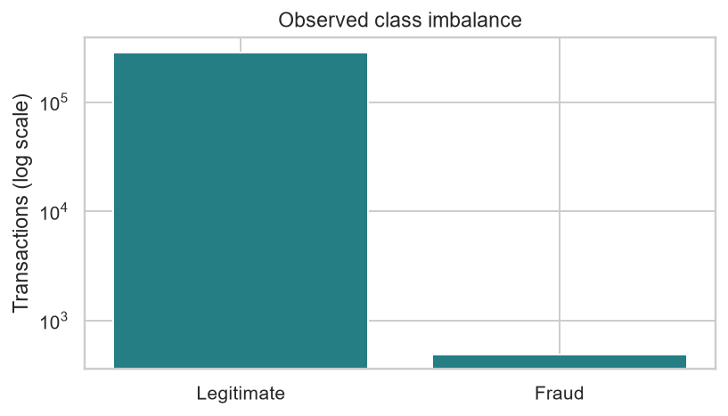

*Figure 1. Observed class distribution on a logarithmic scale.*

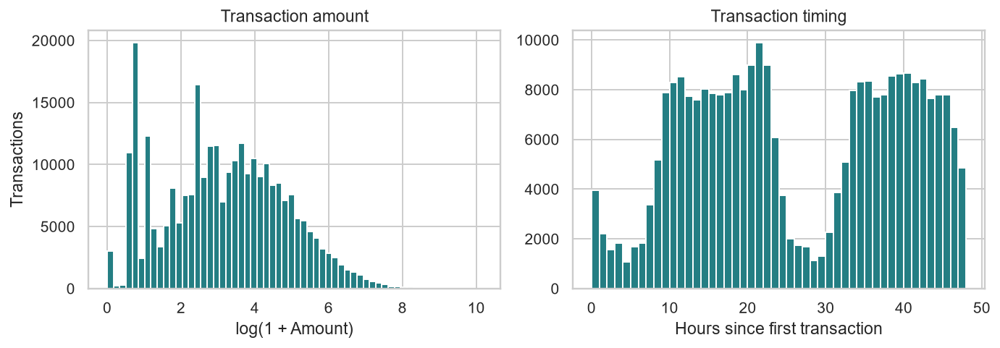

*Figure 2. Amount and elapsed time distributions.*

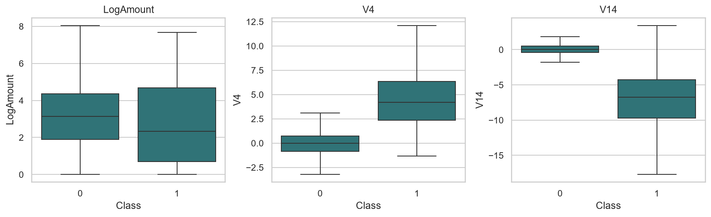

*Figure 3. Amount and two selected PCA-derived features by class.*

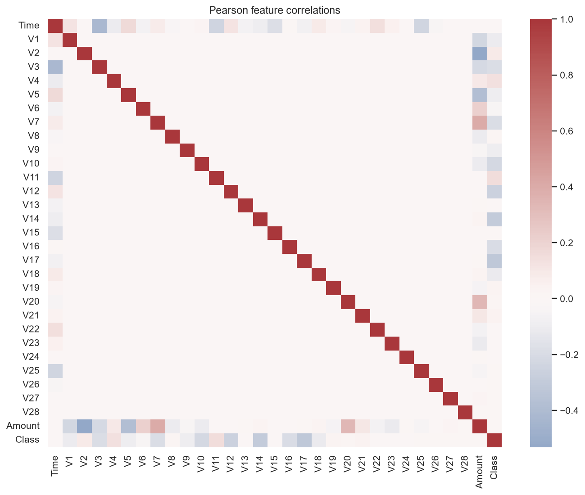

*Figure 4. Pearson correlations in the observed dataset.*

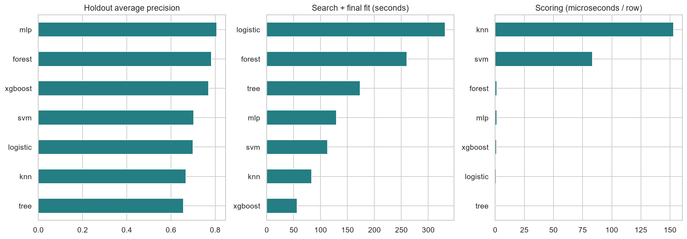

*Figure 5. Holdout AP, model search and fit time, and holdout scoring time.*

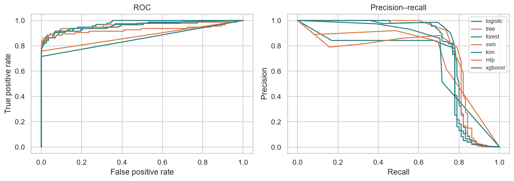

*Figure 6. Holdout ROC and precision–recall curves from continuous scores.*

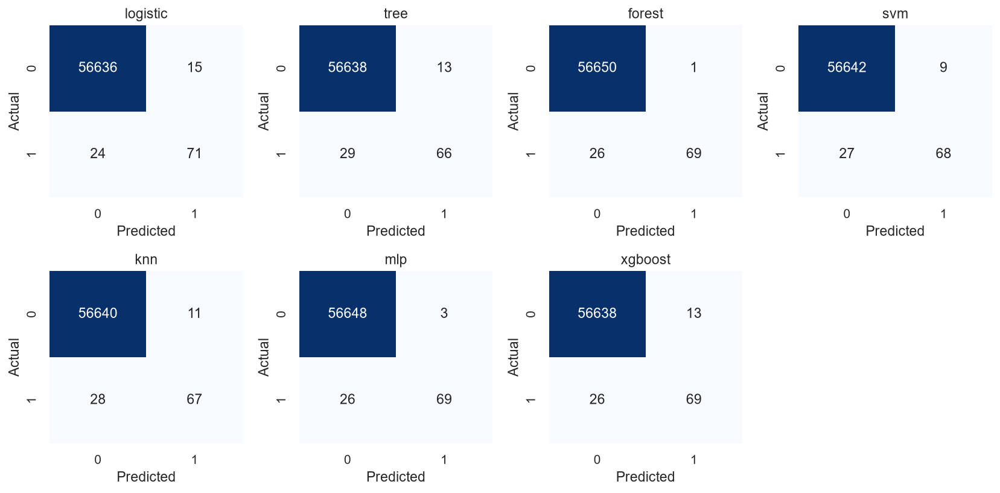

*Figure 7. Holdout confusion matrices at validation-selected thresholds.*

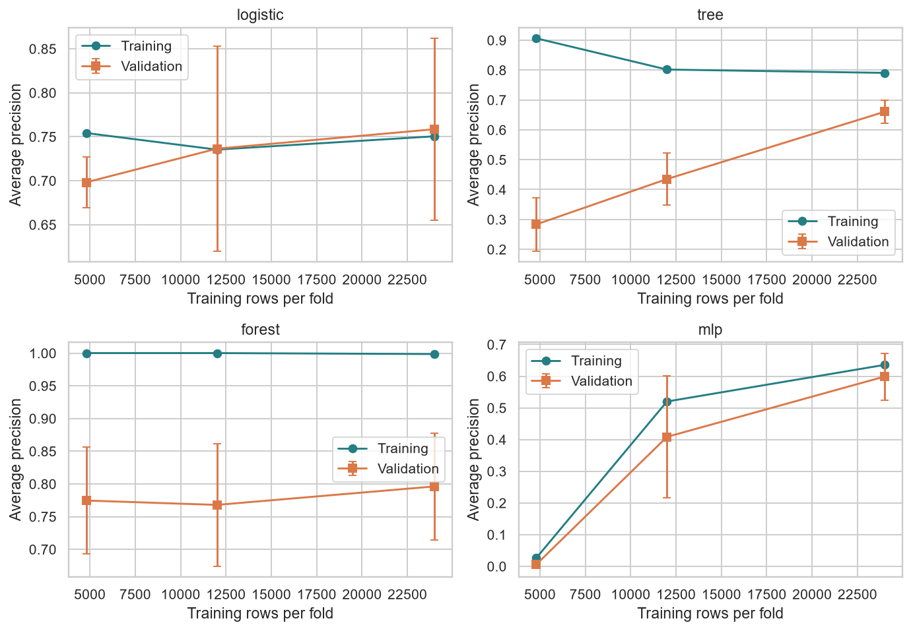

*Figure 8. Average precision against training size. Validation bars indicate fold standard deviation.*

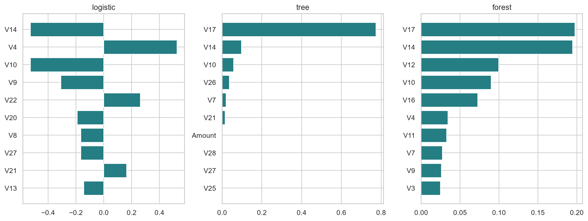

*Figure 9. Logistic coefficients and tree impurity importance for the ten largest values.*

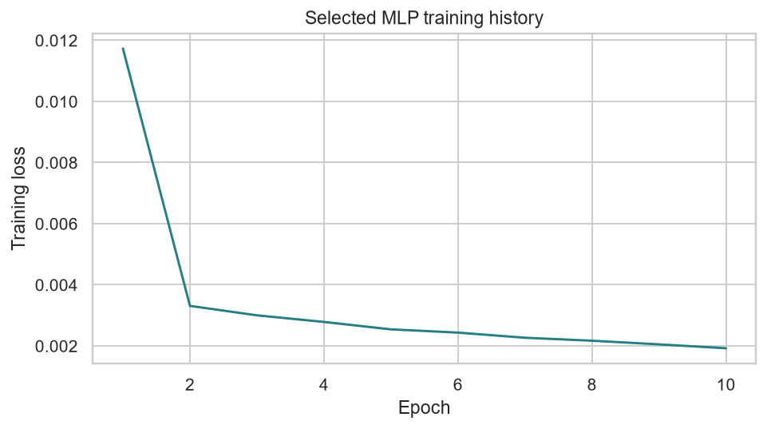

*Figure 10. Selected MLP's training loss across epochs.*

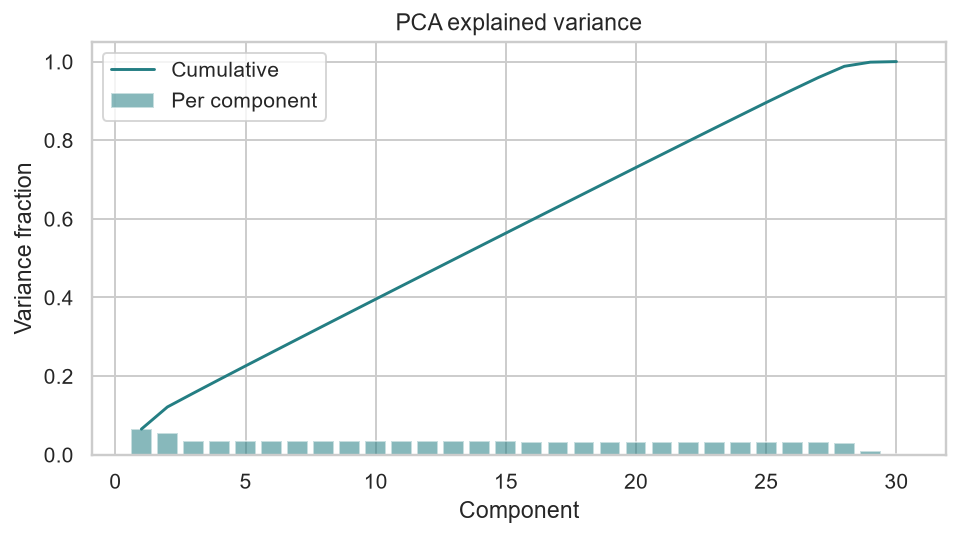

*Figure 11. Per-component and cumulative explained variance of training PCA.*

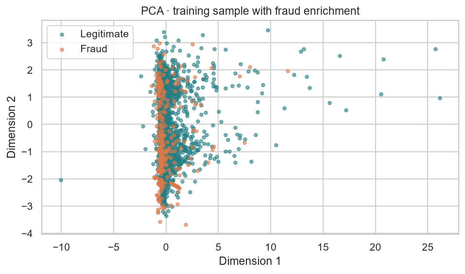

*Figure 12. Two-component PCA projection of the fraud-enriched training sample.*

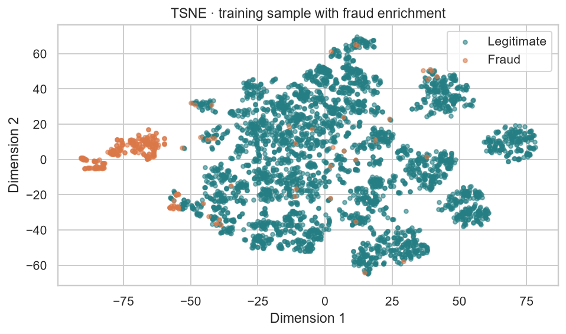

*Figure 13. t-SNE embedding of the same training sample.*
